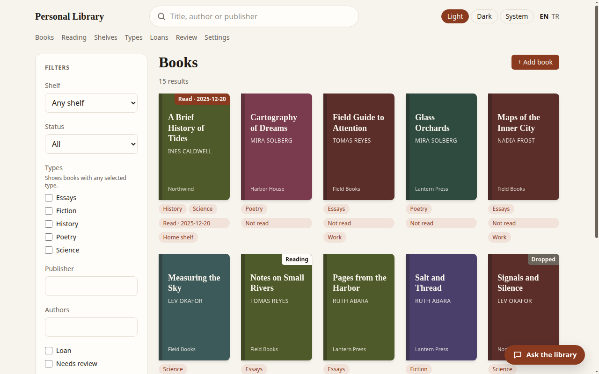
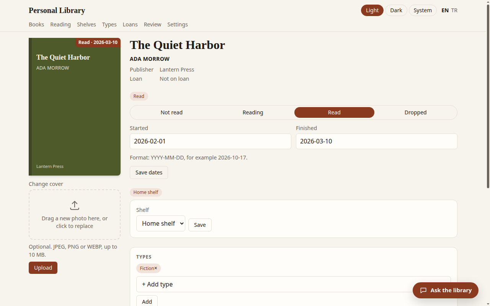
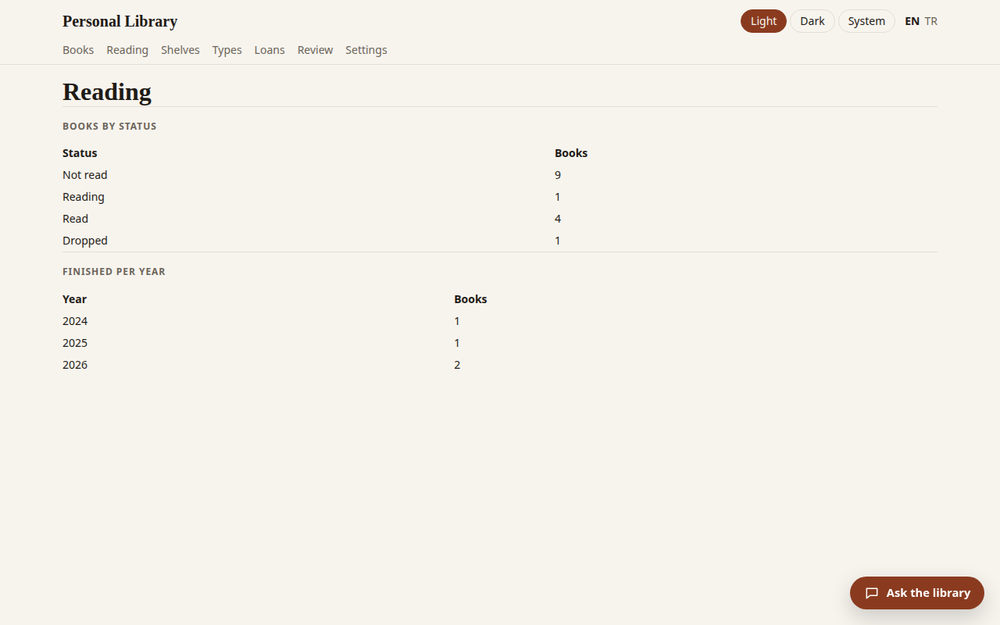
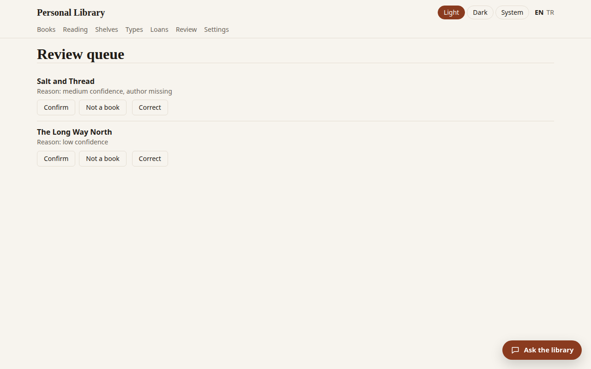

# Personal Library

A single-user personal book library. You browse, search and edit your books in a web page that runs on your own computer in Docker. Your data never leaves it. The interface is available in English and Turkish.

<p align="center">
  
</p>
<p align="center">
  
</p>
<p align="center">
  
  
</p>
<p align="center"><sub>Screenshots use fictional demo books, not the real library. Covers are generated by the app.</sub></p>

## Features

- Book list with search and filters (shelf, reading status, types, publisher, authors, review state), 15 books per page
- Book details with cover photos, reading status, reading dates, shelf and types
- Shelves and types, managed on their own pages
- Loans: lend a book, record its return, and see the loan history
- Review queue for entries that need a second look
- Reading overview: books per status and books finished per year
- Local AI assistant that answers questions about your library (optional, see below)
- CSV export and database backups from the Settings page

## Quick start

Requirements: Docker with Compose.

1. Start the app from the project directory. No configuration is needed; the defaults work out of the box:

   ```bash
   docker compose up -d --build
   ```

2. Open http://localhost:8765 in your browser.

To change a setting, copy `.env.example` to `.env` and edit it. See Configuration below.

## Configuration

Settings are read from `.env`. The file is not committed.

| Variable | Default | What it does |
| :--- | :--- | :--- |
| `LIBRARY_RAW_DIR` | `./data/raw` | Folder with the raw import data. Mounted read-only at `/raw` inside the container. |
| `LIBRARY_LLM_URL` | `http://host.docker.internal:1234/v1` | Address of the OpenAI-compatible server used by the assistant. |
| `LIBRARY_LLM_MODEL` | empty | Model name to request from that server. |
| `LIBRARY_LLM_TIMEOUT` | `60` | Seconds to wait for the assistant before giving up. |

## Language

English is the default. Switch to Turkish with `?lang=tr`, for example http://localhost:8765/?lang=tr. The choice is remembered in a cookie named `lang`. Use `?lang=en` to switch back, or use the EN / TR links in the header.

## Local AI assistant

The assistant answers questions such as "which books by this author do I have?" and suggests similar books. It uses a language model you run yourself, for example with LM Studio on the host machine. Start the local server, load a model, and set `LIBRARY_LLM_MODEL` to its name. If the server is not running, the rest of the app works normally.

## Importing the raw data

The one-time import reads the `*.jsonl` files from the mounted raw folder and writes into the `library-data` volume. It is safe to run again: existing books are not duplicated, and the script fails without writing anything if the counts differ from the expected ones (431 books, 78 review items, 410 photos).

```bash
bash scripts/import_books.sh
```

After the import, the database in the volume is the only source of truth. The Excel and CSV files are not used by the app.

## Backups

Open the Settings page (http://localhost:8765/settings) and press the backup button. Backups are written inside the volume to `/data/backups`. To copy them to the host:

```bash
docker compose cp library:/data/backups ./backups
```

## Repository contents

| Path | What |
| :--- | :--- |
| `src/library/` | The application: web routes and templates (`web/`), database access (`db.py`), import, covers, the assistant and translations (`i18n.py`). |
| `tests/` | Pytest tests for the database, the web pages, the importer and the assistant. `test_smoke.sh` checks the running container. |
| `scripts/` | `import_books.sh`, the one-time import. |
| `tools/` | `fetch_assets.sh` downloads the Tailwind CLI into `tools/` and HTMX into the static folder. |
| `Dockerfile`, `docker-compose.yml` | The image and the single service with its data volume. |
| `pyproject.toml` | Python package metadata and dependencies. |

## Data and privacy

Your book data stays on your computer. The database lives in the Docker volume `library-data`. The `.gitignore` file excludes the database, the `data/` folder, the Excel and CSV files, backups and exports, so none of them are committed to git.

## Stopping

```bash
docker compose down
```

This keeps the `library-data` volume, so your data is preserved. Do not add `-v`, which deletes the volume.

## Development

Requires Python 3.12 or newer.

```bash
python -m venv .venv
.venv/bin/pip install -e ".[dev]"
.venv/bin/python -m pytest -v
```

The smoke test builds and checks the running app, so it needs Docker:

```bash
bash tests/test_smoke.sh
```

Styles are compiled with the Tailwind CLI. If `tools/tailwindcss` is missing, run `bash tools/fetch_assets.sh` first. After changing `src/library/web/static/tailwind.input.css` or any template class, rebuild the stylesheet:

```bash
tools/tailwindcss -i src/library/web/static/tailwind.input.css -o src/library/web/static/app.css -m
```
